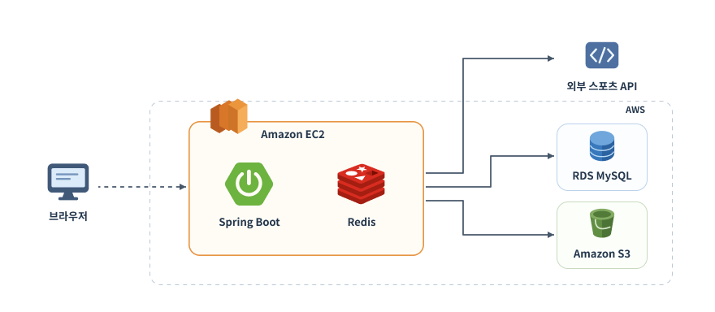

# fantasy-baseball-server

KBO 선수로 팀을 꾸리고, 실제 경기 성적으로 순위를 겨루는 판타지 야구 서버입니다.

## 아키텍처



```text
서버      : EC2 · Spring Boot · Docker Compose
데이터    : RDS MySQL (로스터·점수·순위)
인증      : Redis (갱신 토큰)
이미지    : S3 (선수 사진)
경기 조회 : KBO API · Caffeine
일일 정산 : 매일 02:00 KST · 전날 경기 점수와 순위 집계
```

## 기술 스택
Java 17 · Spring Boot 3.5 · Spring JDBC · MySQL · Flyway · Redis

## 로컬 실행

```sh
docker compose -f docker-compose.local.yml up --build
```

## 테스트

```sh
./gradlew check
```

MySQL·Redis 통합 테스트에는 Docker가 필요하다.

## 개발 현황

```text
ROADMAP [##########......] 63% (40/63)
```

<details>
<summary>기존 기능과 운영 기반 (40개)</summary>

- [x] 프로젝트 범위와 개발 계획 확정
- [x] 서버 프로젝트 초기 구성
- [x] 회원 모델과 DB 스키마
- [x] 회원가입
- [x] JWT 로그인과 갱신 토큰 관리
- [x] 인증 필터와 로그인 세션
- [x] 판타지 야구 기준 데이터 스키마
- [x] KBO API 연동과 캐시
- [x] 선수 목록과 경기 일정 조회
- [x] 로스터 저장과 조회
- [x] 로스터 제출·수정 API
- [x] 경기 시작 후 선수 교체 제한과 동시 수정 제어
- [x] 선수 점수 모델과 계산
- [x] 점수판과 순위 스키마
- [x] 게임 날짜와 일일 마감 기준
- [x] 경기 일정·실시간 상태·로스터 선수 기록 조회
- [x] 일일 정산과 순위 집계
- [x] 점수판과 순위 조회 API
- [x] 이전 일간 순위 표시
- [x] KBO 팀 순위표 조회
- [x] 일일 정산 운영 안정화
- [x] KBO 경기 상태 코드 매핑
- [x] 공통 API 응답과 예외 처리
- [x] 회원가입 이메일 인증
- [x] Redis 갱신 토큰 재발급·삭제의 원자성 보강
- [x] 로그인·인증 요청 제한
- [x] 선수 이미지 수집·S3 저장·조회
- [x] 설정 외부화, Flyway, Docker 배포 기반
- [x] 포지션 규칙과 선수 코스트 계산
- [x] 선수 프로필과 이미지 배치 개선
- [x] KBO 경기 기록 매핑 보정
- [x] 관리자 수동 정산
- [x] 경기일과 정산일 분리
- [x] 인증 토큰을 세션 쿠키로 전달
- [x] Java 17 문법과 모델 정리
- [x] 선수 배점 규칙 조회 API
- [x] 실제 KBO 응답 기반 회귀 테스트
- [x] 설정 바인딩과 트랜잭션 경계 정리
- [x] Docker MySQL·Redis 통합 테스트
- [x] AWS EC2 운영 배포 구성

</details>

### 정산과 로스터

- [ ] 경기일 로스터를 일간 순위에 반영
- [ ] KBO 경기 기록이 누락되면 정산 보류
- [ ] 최신 경기 일정으로 선수 교체 제한
- [ ] 일부 단계가 실패한 정산 재실행
- [ ] 점수판과 순위에서 정산 상태 구분
- [ ] 내 점수판에서 선수별 경기 점수 조회
- [ ] 오래된 버전의 로스터 수정 요청 차단 (서버)
- [ ] 프론트에서 로스터 버전 전송 및 서버에서 버전 필수화

### 계정과 게임

- [ ] 로그인 세션과 토큰 갱신 보강
- [ ] 비밀번호 재설정
- [ ] 시즌 전환과 지난 시즌 순위 조회
- [ ] KBO 기록 정정에 따른 점수·순위 재계산
- [ ] 선수 이미지 갱신 실패 시 재시도

### 운영과 테스트

- [ ] 관리자 정산 상태 조회
- [ ] Spring 테스트 설정과 로컬·CI 실행 방식 정리
- [ ] 운영 도메인 연결과 Nginx·HTTPS 구성
- [ ] API 계약 문서화
- [ ] GitHub Actions에서 테스트 실행
- [ ] 요청과 장애를 추적할 수 있도록 로그 정리
- [ ] 정산 실패·지연 알림
- [ ] 배포 버전 확인과 롤백
- [ ] 랭킹 집계와 조회 병목 측정
- [ ] 게임 규칙과 운영 문서 정리
